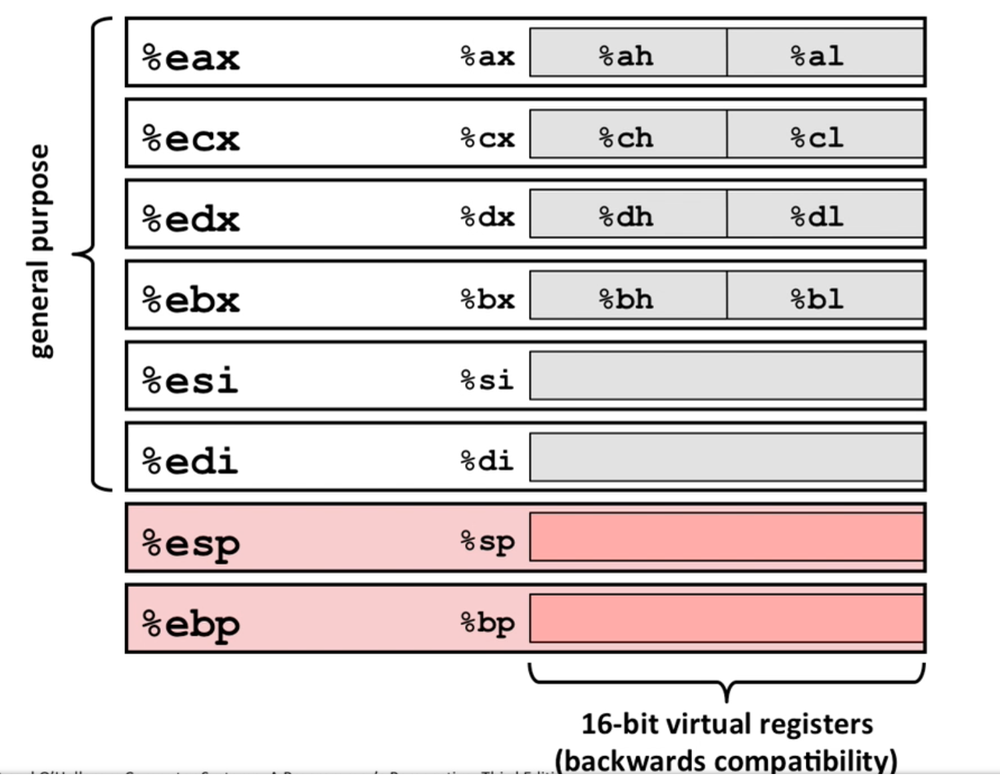
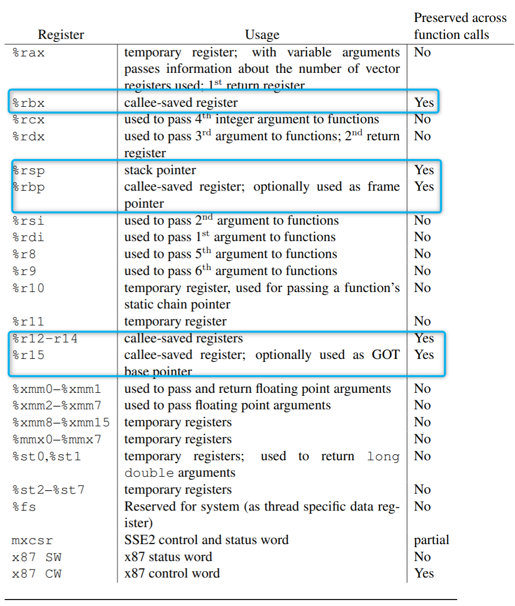

> [!note]
> Using 64-bit Assembly, with AT&T syntax. I have used GNU Assembler to build my assembly programs. Example
> programs related to many concepts are available at : https://github.com/sheharyaar/systems-kernel-asm

## Registers

- `8` registers with names and `8` registers with numbers:
```asm
rax, rbx, rcx, rdx, rsi, rdi, rsp, rbp
r8, r9, r10, r11, r12, r13, r14, r15
```
- **Prefixes**
  - `r` prefix is for 64-bit
  - `e` is for 32-bit (eax, ebx, exc, etc.)
  - no prefix is used for 16-bit or 2 byte- registers (ax, bx, cx, etc.)
  - `h` and `l` suffix is used for 8-bits, where `h` is for higher 8-bit and `l` is for lower 8-bit.


*Fig 1.1 - Register Prefix*

### Caller and Callee Saved

Caller saved (or must be preserved by the caller — the caller can expect the values to be changed after a
function or system call). These are also called as `call-clobbered` registers.

```asm
rax, rcx, rdx, r8-r11
```

Callee saved (the function must store and restore these registers, the caller can expect them to be unchanged)

```asm
rbx, rbp, rdi, rsi, rsp, r12-r15
```


*Fig 1.2 - Caller and Callee Saved Registers. Source: System V ABI Document*

## Debug Registers

There are certain registers that can be used to create exceptions and for debugging purposes. These are discussed in the [Debugging](#) page.
<!-- TODO: attach debug page -->