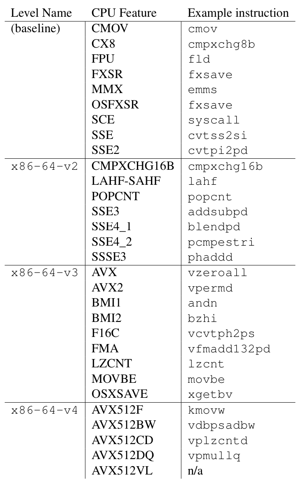
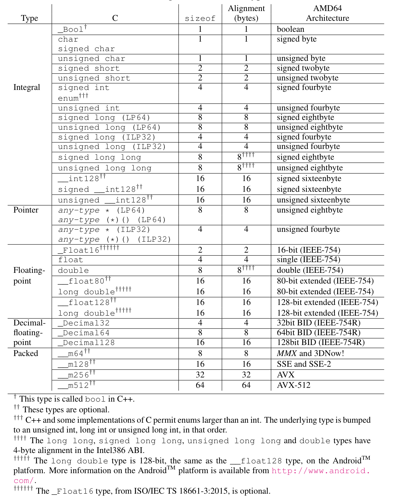

## Processor Features

There are multiple levels of feature that a CPU must implement according to the processor specification. These are called micro-architecture levels. For x86-64, these are: `x86-64-v2`, `x86-64-v3` and `x86-64-v4` .

*Fig 1.1 - CPU Micro-architecture levels*

- Levels `x86-64-v3` and `x86-64-v4` are only available if the features are **fully enabled**.
- The names are expected to be used as directory names by linkers and compilers.
- To build with a given level, the programmer can build a shared object using `-march=x86-64-v3` (or other suitable) GCC flag.
- The resulting shared object is then installed in `/usr/lib64/glibc-hwcaps/x86-64-v3` or `/usr/lib/x86_64-linux-gnu/glibc-hwcaps/x86-64-v3` .

## Data Types — Size and Alignments

*Fig 1.2 - Sizes of static types*

For types of N-bit integers

- If $N<=64$ : they have the same size and alignment as the smallest scalar type (`char`, `short`, etc.) that can contain them.
- If $N > 64$ : treated as struct of 64-bit integer chunks.The size is the $64*N$ where $N$ is the number of chunks that can contain the type, but the alignment is 64-bits.

For Bitfields:

- They are allocated from **right** to **left**.
- Must be contained in a type that can store them.
- Can be shared using unions and with other struct members.
